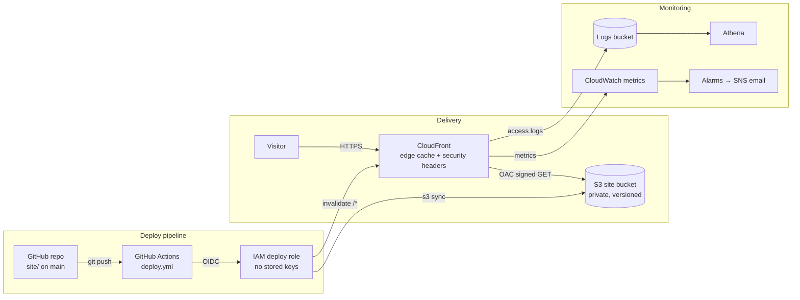

# Secure Static Website Hosting and Content Delivery with Amazon S3 and CloudFront

**Live site:** https://YOUR-DISTRIBUTION.cloudfront.net
**Author:** Mbuotidem Udo · [LinkedIn](https://www.linkedin.com/in/mbuotidem-udo) · [GitHub](https://github.com/mbeeudo)

My portfolio is served from a **private** S3 bucket through **CloudFront** over HTTPS, hardened with security headers, deployed automatically from GitHub **without any stored AWS keys** (OIDC), and monitored with access logs, CloudWatch alarms and Athena.

> Replace every `TODO` below with your own results, then delete this line.

---

## Architecture




## Problem and goals

TODO: two or three sentences. Example: I needed to host my portfolio globally, securely and at near-zero cost. Goals: no public bucket, HTTPS only, strong browser security headers, automatic deployments without long-lived credentials, and visibility into traffic and errors.

## Services used

| Service | Role in this project |
| --- | --- |
| Amazon S3 | Private, versioned, encrypted storage for the site files |
| Amazon CloudFront | HTTPS delivery from edge locations, caching, security headers |
| Origin Access Control (OAC) | Lets only my distribution read the bucket |
| AWS IAM + OIDC | Short-lived credentials for GitHub Actions; least-privilege deploy role |
| GitHub Actions | Deploys on every push to `main` |
| CloudWatch + SNS | Error-rate alarms with email alerts |
| Athena | SQL queries over CloudFront access logs |
| CloudTrail, AWS Budgets | Audit trail and cost guardrail |

## Build steps

1. Private S3 bucket with Block Public Access, versioning and SSE-S3 — [screenshots 01–04](screenshots/)
2. CloudFront distribution with OAC, HTTPS redirect and default root object — [05–09](screenshots/)
3. Response headers policy (HSTS, CSP, X-Frame-Options and more) — [10–15](screenshots/)
4. Caching and invalidation — [16–17](screenshots/)
5. GitHub Actions deployment through OIDC — [18–24](screenshots/)
6. Monitoring: reports, CloudWatch alarms, access logs and Athena — [25–32](screenshots/)
7. Cost and audit controls — [33–35](screenshots/)

## Security controls

| Control | Implementation | Evidence |
| --- | --- | --- |
| Private origin | S3 Block Public Access on; direct S3 URL returns 403 | `04-s3-direct-access-denied.png` |
| Origin locked to my distribution | Bucket policy with `AWS:SourceArn` condition | `06-oac-bucket-policy.png` |
| Encryption in transit | Redirect HTTP to HTTPS; HSTS | `13-curl-security-headers.png` |
| Encryption at rest | SSE-S3 default encryption | `02-s3-versioning-encryption.png` |
| Browser security headers | CloudFront response headers policy | `10/11-securityheaders-before/after.png` |
| No long-lived credentials | GitHub OIDC → IAM role, restricted to `main` of this repo | `19-iam-role-trust-policy.png`, `23-actions-run-denied.png` |
| Least privilege | Deploy role can only sync this bucket and invalidate this distribution | `20-iam-role-permissions.png` |
| Audit trail | CloudTrail event history | `34-cloudtrail-oidc-event.png` |
| Recovery | S3 versioning | `02-s3-versioning-encryption.png` |

## Configuration decisions

See [docs/decisions.md](docs/decisions.md).

## Monitoring findings

TODO: cache hit ratio from Athena, top edge locations, error codes seen, any scanner traffic (for example requests for `/wp-admin` or `/.env`) and how the private origin handled it. Include screenshots 25–32.

## Troubleshooting

See [docs/troubleshooting.md](docs/troubleshooting.md).

## Cost

TODO: what the project actually cost per month (from Billing), and the $5 budget alert in place.

## What I learned and next steps

TODO: three to five bullets. Next steps could include Terraform, a custom domain with Route 53 and ACM, AWS WAF, and removing `'unsafe-inline'` from the CSP.

## Repository layout

```text
site/                      website files (changes here trigger a deploy)
.github/workflows/         GitHub Actions pipeline
infra/                     bucket policy, OIDC trust policy, deploy permissions, CSP
athena/                    table definition and queries for CloudFront logs
scripts/verify.sh          curl checks for HTTPS, headers, caching and private origin
docs/                      architecture diagram, decisions, troubleshooting
screenshots/               evidence, numbered by build step
```
